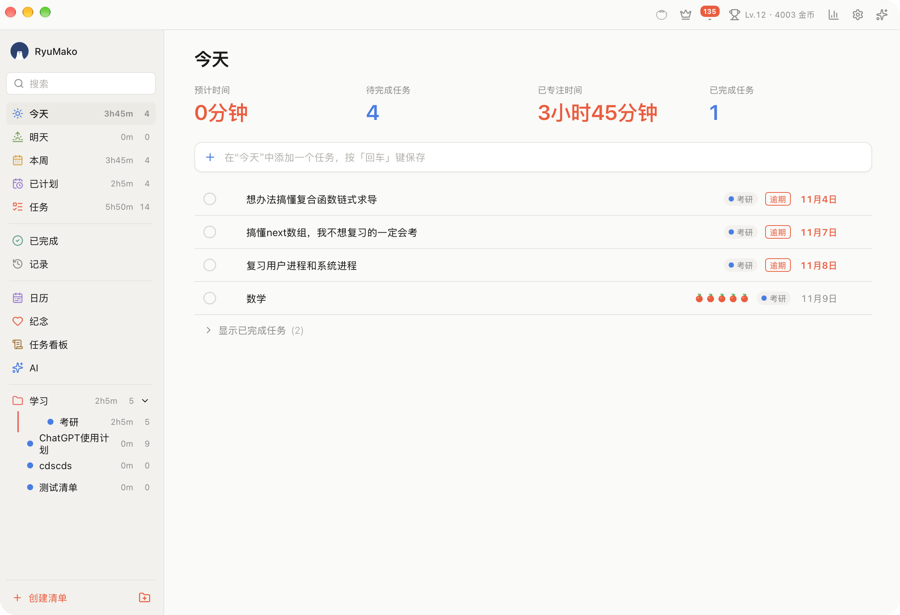
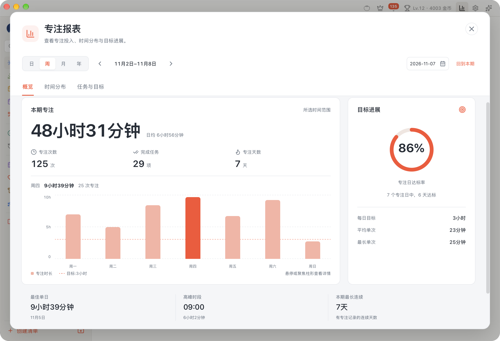
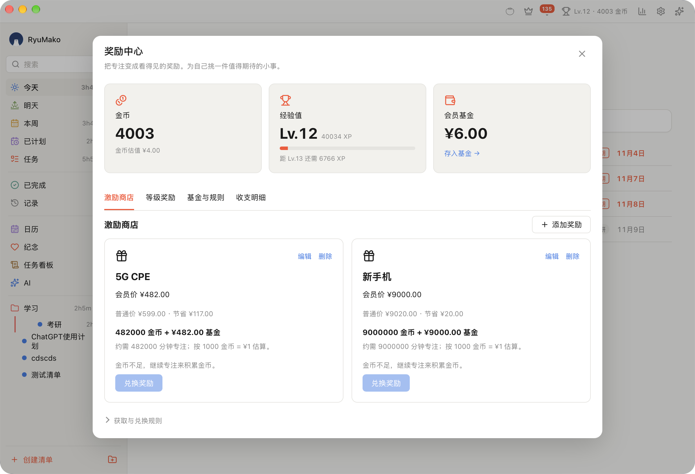

# FocusPomodoro

番茄钟 × 任务管理桌面应用 —— 依据 `CLAUDE.md`（PRD v1.0）实现。

技术栈：**Tauri 2.x（Rust + SQLite） + React 19 + TypeScript + Vite**。

<p align="center">
  
</p>

FocusPomodoro 是一款将番茄专注、任务管理与成长奖励结合起来的桌面应用。支持 macOS、Windows、Linux 桌面运行，也可在浏览器中使用。

### 应用截图

| 应用首页 | 专注报表 | 奖励中心 |
| --- | --- | --- |
|  |  |  |

---

## 快速开始

```bash
npm run dev            # 前端开发服务器（浏览器，IndexedDB 承载数据）
npm run build          # 类型检查 + 前端打包到 dist/
npm run tauri dev      # Tauri 桌面应用（开发模式）
npm run tauri build    # 打包桌面安装包
```

首次运行写入 PRD §6.3 的截图还原数据（与 S1–S5 逐屏比对）：浏览器走 `src/db/seed.ts::buildSeed`，桌面走 `src-tauri/src/db.rs::seed_demo`，两端同一种子，并用 `settings.demo_seeded=1` 防重播。「删除数据」与「注销账号」都是回到空业务表 + 默认用户 + 已播种标记，重启不会回填演示数据。

---

## 架构

严格按 PRD §8.2 / §8.3 分层：

```
src/                       前端（UI 层）
├── api/                   桥接层：invoke 封装（§8.4 命令面）
│   ├── index.ts           运行时分派：Tauri → Rust，浏览器 → IndexedDB
│   ├── tauri.ts           invoke/listen 适配器
│   ├── local.ts           本地适配器（同一命令面）
│   └── events.ts          data://changed 等事件总线（§8.5）
├── db/                    数据层：§6.2 表结构 + §7.2 统计口径
│   ├── idb.ts             IndexedDB 持久化（浏览器运行时）
│   ├── queries.ts         分类筛选 / 统计 / 报表数据源
│   └── seed.ts            §6.3 截图还原数据
├── stores/                Zustand：task / timer / stats / ui
├── timer/engine.ts        计时引擎（基于绝对时间戳，§8.8-1）
├── pages/ modals/ components/ charts/ styles/ assets/

src-tauri/                 后端（Rust 核心）
├── src/
│   ├── lib.rs             Builder / 状态注册 / setup（迁移 + 默认用户）
│   ├── main.rs            入口
│   ├── db.rs              §6.2 迁移 + `ensure_bootstrap` + 首启 `seed_demo`（demo_seeded 守卫）
│   ├── models.rs          实体模型
│   ├── error.rs           统一错误
│   ├── timer_engine.rs    §7.1 状态机 + §8.5 timer://tick 广播
│   └── commands/          user / lists / tasks / records / stats / settings / notify / auth
├── capabilities/default.json
├── tauri.conf.json  (+ .windows / .linux 平台覆盖)
└── Cargo.toml

tools/                      验收与维护脚本（见「验证」）
src/lib/                    跨层工具：pb.ts（PocketBase）、sync.ts（云同步裁决）、systemNotify.ts
```

### 数据流

UI → Zustand → `src/api`（invoke）→ Rust `commands/*` → SQLite(`app_data_dir/focus.db`)
变更后经 `data://changed` 事件回推，报表实时重算（§8.8-3）。

---

## 关键实现说明

### 计时可靠性（§8.8-1）
所有倒计时由**绝对时间戳**推导：`remaining = end_at - now`，不存在 `setInterval` 累加计数，
因此跨休眠、CPU 阻塞、进程重启均不漂移。暂停写入 `paused_remaining_ms`。

- **Tauri 运行时**：Rust `timer_engine` 每 250ms 广播 `timer://tick`（含权威 `remaining_ms`），
  前端以此为准；阶段切换仍由前端状态机单属主执行，避免重复归档。
- **浏览器运行时**：本地 250ms 脉冲提供同一语义。

### 单属主原则
`focus_record` 的写入只发生在一处（前端 `checkExpiry` → `create_focus_record`），
Rust 侧不重复结算，保证一次番茄恰好归档一条记录。

### 统计口径（§7.2）
全部指标由 SQL 实时聚合，无前端缓存。浏览器运行时由 `src/db/queries.ts` 用等价逻辑计算，
两侧口径逐项对齐（见 `tools/verify-data.ts`）。

### 平台适配（§8.7）
- macOS：`titleBarStyle: "Overlay"` + `hiddenTitle`，保留系统红黄绿；
- Windows / Linux：`tauri.windows.conf.json` / `tauri.linux.conf.json` 覆盖为 `decorations: false`，
  由 `TitleBar.tsx` 自绘红黄绿按钮。

---

## 与 PRD 的差异

受离线环境与可得依赖限制，以下三处未使用 PRD 指定的库，但**功能与数据口径等价**，且已在代码中标注：

| 项 | PRD §8.1 指定 | 本实现 | 说明 |
| --- | --- | --- | --- |
| 路由 | react-router-dom v6（内存路由） | `uiStore` 内存路由状态 | 依赖不可得；同一 §2.3 路由表语义（`/tasks`、`/today`…、`/lists/:id`） |
| 图表 | ECharts 5 | 手写 SVG 组件 | 依赖不可得；`charts/` 下热力网格、环形图、日历、进度条均为 SVG，视觉与数据映射一致 |
| 白噪音 | 打包本地音频资源 | Web Audio 合成（滤波噪声） | 5 段本地环境音循环播放、音量可调、失败静默降级（§8.8-5）；选择入口统一为**弹窗**（6 项含「无」、圆形封面取自 mp3 内嵌图、试听→确定才落库、取消回滚）。样式来自用户设计稿，超出 PRD |
| 云同步 | §8.6 列为可扩展项（非目标） | PocketBase 云端对齐层 | 设置 → 账号即软件账号（登录/注册、改密码、忘记密码、头像上传/移除、昵称就地编辑（邮箱只读）、同步区、退出）；退出登录只清会话、不清本地数据；本地仍为断网时真相源；集合 `users`/`configs`；地址按「`settings.pb_url`（库内可配）＞ `VITE_PB_URL` ＞ 内置 `http://62.234.82.11:28193`」优先级解析；PB 不可达时静默降级、不阻塞本地；端到端 36/36 已实测 |

> **同步服务器配置**：PocketBase 服务器地址可在库内一键设置，多机可连不同后端。见
> [`docs/09-sync-server.md`](docs/09-sync-server.md)，一行脚本：
> `node scripts/set-sync-server.mjs https://pb.example.com`（写的是 `settings` 表里的值；`""` 恢复编译期默认）。

另：

- **报表「目标完成率」**：截图显示 70%，但按 §7.2 公式 `2/3` 应为 67%。PRD 已注明以算法为准，
  故实现输出 **67%**。
- **悬浮小窗番茄数**：截图为 5（其演示数据），本实现按 §1.3 语义显示**当日实时番茄数**。
- **番茄界面背景**：截图为照片级海浪实景，本实现为分层 SVG 海浪场景（无图片素材）。
- **首次运行数据**：两端按同一份 §6.3 写入截图还原数据（浏览器 `buildSeed` / 桌面 `seed_demo`），
  并以 `demo_seeded=1` 防重播；「设置 → 账号 → 删除数据」清空后回到空业务表 + 默认用户，不重播种。

---

## 验证

```bash
# 一键验收（推荐，共 7 步）：tsc → 红线 → 种子口径 → 计时口径 → cargo test → build → 可选截图 16 检查
bash tools/check-all.sh              # 静态/构建检查
bash tools/check-all.sh --with-shots # 追加 Playwright 截图验收（自动起 preview）
bash tools/check-all.sh --skip-build # 只查类型与测试

# 单项执行
npx esbuild tools/verify-data.ts --bundle --platform=node --format=esm \
  --alias:@=./src --outfile=/tmp/verify.mjs && node /tmp/verify.mjs   # §7.2 数据口径
npx tsx tools/verify-timer.ts                                       # 三模式计时口径（20 项）
./tools/check-runtime-parity.sh                                     # UI 不得直连存储
cd src-tauri && cargo test --test queries                           # Rust 统计口径（16 项）
```

覆盖项：6 张统计卡片、侧边栏角标（含已完成/记录两个口径）、记录视图分组、已完成任务归档分组、番茄记录图、专注时间详情、
清单分布、每日目标日历、今日面板。

`tools/shoot.mjs` 用于截图比对：先 `npm run build && npx vite preview --port 4173`，再 `node tools/shoot.mjs`；
直接跑 `bash tools/check-all.sh --with-shots` 则会在 4173 无服务时自动起 preview。
**注意 4173 预览的是 `dist/`**——改完源码不重新 `vite build`，预览与截图仍是旧产物（此坑已踩）。
它按结构选择器（不依赖中英文文案）依次截 S1–S5、深色主题（S1/S4/S5）与英文界面，并做 9 项自动检查（含白噪音弹窗结构、计时模式菜单与起始值）
（首屏渲染、账号页结构断言（`.acct-section` ≥ 2、邮箱/密码框、`.acct-row-actions .btn.primary`、`.acct-link`、`.btn.danger`，旧 `.account-card`/`.profile-*`/`.cloud-card` 须为 0、未登录无 `.acct-badge`/`.acct-avatar`）、白噪音弹窗、计时模式菜单三项一行与起始值、悬浮窗/专注页壁纸非 `none`、深色低对比度、英文残留、console/pageerror）；
产物写入 `SHOT_DIR`（默认 `/tmp/shots`），有 console 错误或断言失败时退出码非 0。
`APP_URL`、`SHOT_DIR` 可用环境变量覆盖；仅 Playwright 导入路径与本机 Chrome 路径
（`tools/shoot.mjs` 顶部的 `CHROME` 常量）为硬编码，换机器需改这两处。
`tools/extract-noise-covers.sh` 从 `src/assets/noise/*.mp3` 的 ID3 内嵌封面重抠弹窗封面图（换音频后重跑；缺图会让 `tools/shoot.mjs` 直接失败）。
`tools/verify-timer.ts` 是三模式计时的纯函数自检（20 项，`npx tsx` 直跑，`check-all.sh` 第 4 步）。
`tools/link-bins.mjs`、`tools/vendor-deps.mjs` 为依赖/打包辅助脚本，不参与验收。

---

## 数据存储

| 运行时 | 位置 |
| --- | --- |
| Tauri | `app_data_dir/focus.db`（SQLite，WAL） |
| 浏览器 | IndexedDB `focus_pomodoro` |

两者共用 §6.2 表结构与 §7.2 口径，切换运行时数据语义一致。

---

## 文档索引

完整规格与开发文档见 `docs/`（入口 `docs/00-README.md`）：

Flutter 移动端开发的独立文档集见 [`mobile-docs/`](mobile-docs/README.md)，包含 Codex 实现指令、桌面功能对照、同步契约、工程架构、阶段计划和验收矩阵。

| 文档 | 内容 |
| --- | --- |
| [`01-vision.md`](docs/01-vision.md) | 产品愿景 |
| [`02-roadmap.md`](docs/02-roadmap.md) | 路线图 + 当前状态 + 差距 |
| [`03-architecture.md`](docs/03-architecture.md) | 双运行时架构 / 数据流 |
| [`04-data.md`](docs/04-data.md) | 数据契约与口径 |
| [`05-modules/*.md`](docs/05-modules/) | 各功能域模块规范 |
| [`06-acceptance.md`](docs/06-acceptance.md) | 全量验收清单 |
| [`07-backlog.md`](docs/07-backlog.md) | 待办池 |
| [`08-changelog.md`](docs/08-changelog.md) | 变更记录 |
| [`09-sync-server.md`](docs/09-sync-server.md) | **同步服务器（PocketBase）配置 + 一键脚本** |

## 奖励中心

点击顶栏奖杯，可添加按会员价估值的激励商品、配置等级奖励并管理会员基金预算。新归档专注每分钟获得 1 金币和 10 XP；默认 10 金币估值 ¥1，支持调整。商店兑换同时扣金币与基金，等级奖励达标后仅扣基金且每级只领一次。基金用于本地预算记账，实际商品由用户自行购买。账本重启保留，仅存本机；历史记录不补发收益。详见 [成长模块](docs/05-modules/growth.md)。

会员购买入口位于顶栏皇冠或「设置→会员」，只提供周付/月付。首次在「设置→关于→高级选项→奖励计划管理」上传并保存微信、支付宝收款码，日常会员页点击支付；两张码同时展示，用户自觉点击「付款成功」后，会员款全额进入基金并延长会员期限。基金充值使用相同流程，不校验实际付款。收款账户及手机提醒由用户在银行/支付工具中自行设置。

收款码、会员价格与金币估值规则仅在上述二级管理页中显示，设置完成后不会在会员页或基金页主动出现。设置界面采用新的侧栏与分组表单布局，支持深色主题和窄窗口。

## macOS 系统小组件

macOS 14+ 支持小、中、大三种原生组件，展示当前计时、今日目标、待办和近七天专注趋势，支持深浅色。安装新版应用并启动后，可从桌面或通知中心的「编辑小组件」添加 **FocusPomodoro / 专注时光**。

构建会自动嵌入 WidgetKit 扩展。构建、App Group 签名要求及验收范围见 [小组件说明](docs/05-modules/widgets.md)。

本机签名已配置后，继续使用 `npm run tauri build` 即可：构建入口会读取 `macos/signing.local`，统一签署主应用和小组件，并检查共享组与权限。该文件已被 Git 忽略，只保存证书引用和团队 ID。换机器时需要重新配置本机证书。

安装更新前先退出应用，再使用 `npm run mac:install` 安全安装 release 包，避免覆盖原可执行文件。自定义路径或 debug 包仍可直接传给 `scripts/install-macos-widget-repair.sh`。
